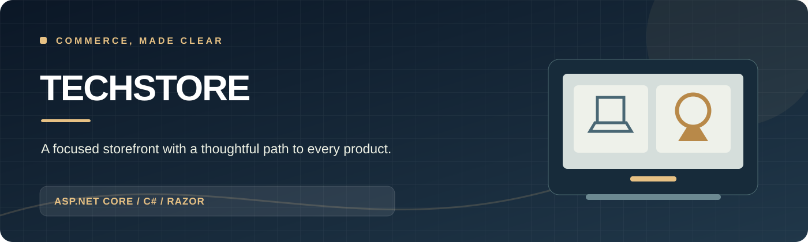
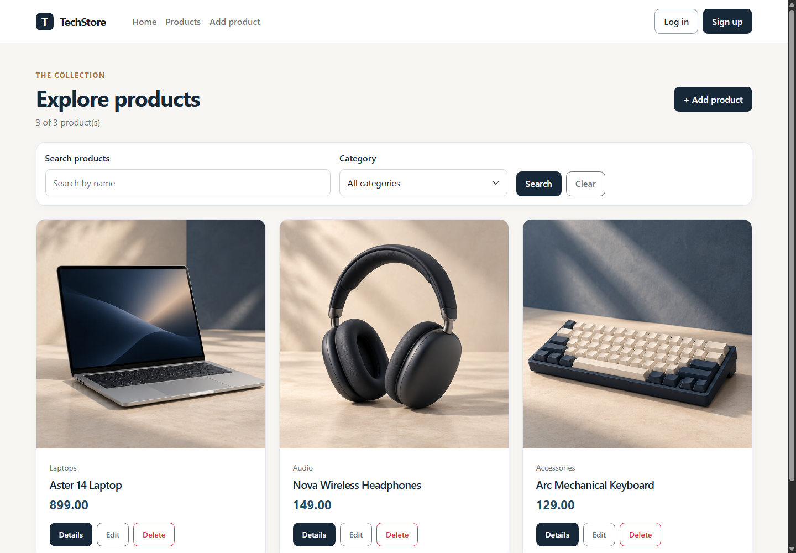
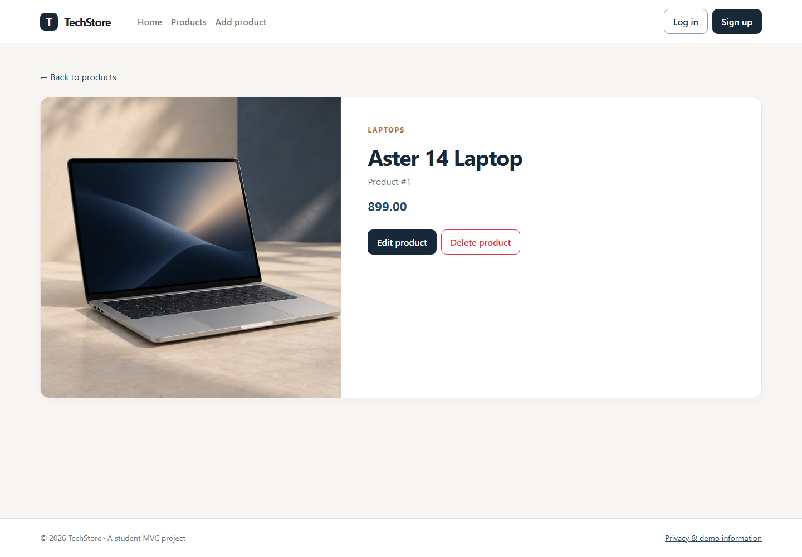
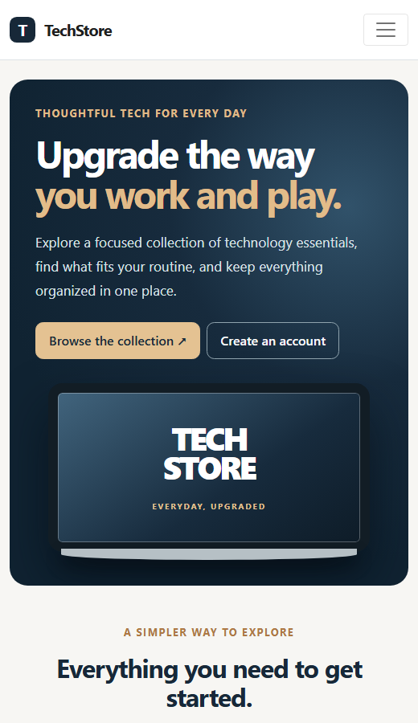
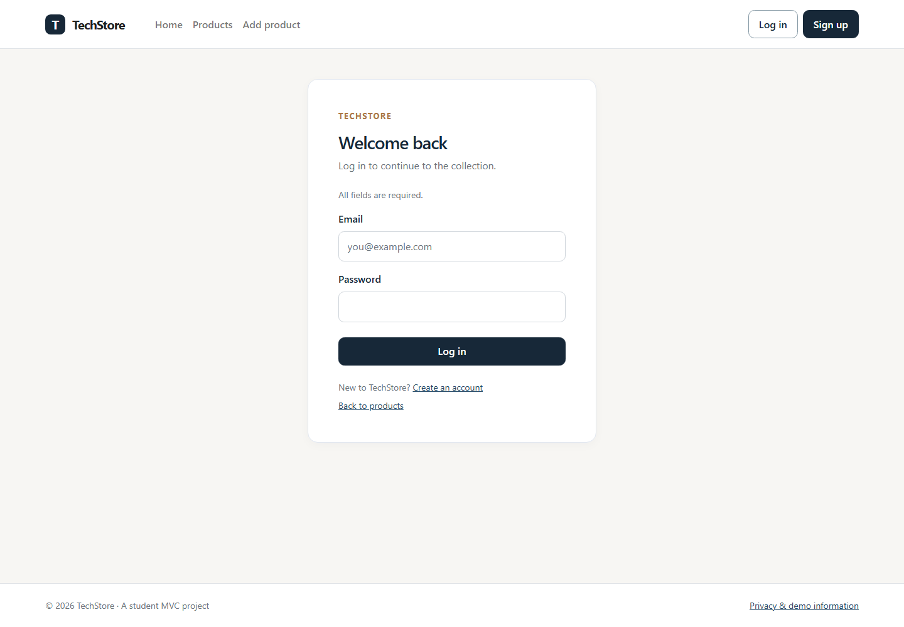
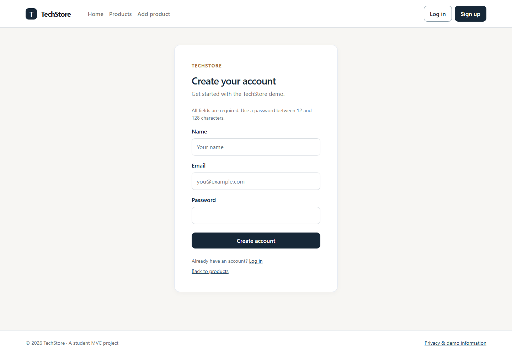

# TechStore E-Commerce

[Screenshots](#screenshots) | [Features](#features) | [Run locally](#run-locally)

TechStore is the main ASP.NET Core MVC storefront in this workspace, built with C# and .NET 8.

The storefront has a refined responsive visual style, including a more prominent landing hero, clearer navigation, and improved focus and form states.

The project was created as a Computer Science portfolio project and demonstrates core web development concepts such as authentication, CRUD operations, validation, search, filtering, and responsive UI design.

The separate `techstore-clean` project is an earlier prototype retained for reference. This is the fuller version with hashed passwords, cookie authentication, search, filtering, and protected product management.

## Features

- User registration and login
- Secure password hashing using ASP.NET Core `PasswordHasher`
- Cookie-based authentication
- Logout functionality
- Public product browsing
- Add products
- Edit products
- Delete products
- Product search
- Product filtering
- Product count
- Server-side validation
- Responsive Bootstrap interface
- Empty-state messages
- Success and error notifications
- Protected product management pages for authenticated users

## Technologies Used

- C#
- ASP.NET Core MVC
- .NET 8
- Razor Views
- Bootstrap
- HTML5
- CSS3
- JavaScript
- ASP.NET Core Authentication

## Security

The project includes basic authentication security improvements:

- Passwords are stored as secure hashes instead of plain text
- Authentication cookies are used to maintain login sessions
- Product creation, editing, and deletion require authentication
- Logout requests are protected with anti-forgery validation
- Sensitive credentials are not stored in `appsettings.json`
- Passwords are not displayed in views or error messages

## Screenshots

Captured from the running local application. The product cards show three temporary example products added only for the gallery; a fresh run starts with an empty in-memory catalog. Laptop, audio, and accessories use illustrative generated studio photography, not photos of real inventory. Other categories retain the neutral placeholder.

| Storefront | Product catalog |
| --- | --- |
|  |  |

| Product details | Narrow storefront |
| --- | --- |
|  |  |

<details><summary>Account screens</summary>

| Login | Sign up |
| --- | --- |
|  |  |

</details>

## Project Structure

```text
techstore/
├── Areas/
├── Controllers/
├── Data/
├── Models/
├── Properties/
├── Services/
├── Views/
├── wwwroot/
├── Program.cs
├── appsettings.json
├── appsettings.Development.json
└── techstore.csproj

screenshots/
README.md
techstore.sln
.gitignore
```

## Run locally

Install the .NET 8 SDK. From this repository root run:

```powershell
dotnet run --project .\techstore\techstore.csproj
```

Open the URL printed by `dotnet run`. Browse products without an account; use **Sign up** to create a local demo account before adding, editing, or deleting products. Accounts are stored in `techstore/App_Data/users.txt` by default and that directory is ignored by Git. Products are held in memory and reset when the app restarts. The separate ASP.NET Identity database requires SQL Server LocalDB only when using its Identity pages; the storefront account flow uses the file store.
